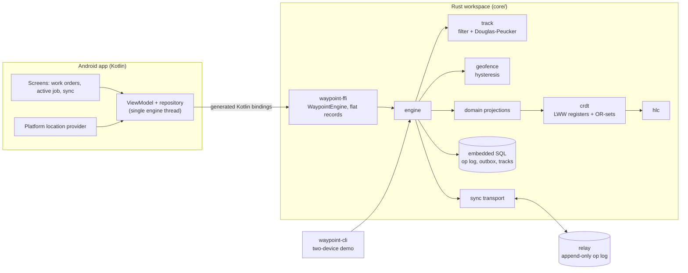

# waypoint-android

Offline-first field app for mobile crews: a Rust core for GPS track recording, geofence alerts and conflict-free sync, shared with an Android Kotlin UI through generated foreign-function bindings.


## What it demonstrates

- **Conflict-free replication from an op log.** Every edit is an operation stamped with a hybrid logical clock. Scalar fields are last-writer-wins registers; tags, notes and photo metadata are observed-remove sets. Property-based tests check that merge is commutative, associative and idempotent, and that op delivery order and duplicates do not change the result.
- **Transactional outbox.** A local edit and its outbox entry are written in one embedded-database transaction, so an edit can never be visible locally and still be lost before upload. Failed pushes stay queued with an attempt count and the last error.
- **Track recording.** Fixes are filtered as they arrive (accuracy gate, jitter, out-of-order, implied-speed outliers). The track is then simplified with an iterative Douglas-Peucker pass under a metric tolerance, with distance, duration and moving-time stats.
- **Geofences with hysteresis.** Circle and polygon fences use a signed boundary distance, a dead band around the edge and an N-consecutive-fix confirmation, so a worker standing at the fence line does not trigger a stream of enter/exit events.
- **Geofence-gated check-in.** The core returns a `CheckInState` (allowed, outside, no fix yet, already checked in, closed). The Android check-in button only renders that value, so the rule lives in one tested place.
- **One core, three hosts.** The same Rust engine runs the host CLI demo, the integration tests and the Android app. The Kotlin side has no domain logic, and its bindings are generated at build time from metadata embedded in the compiled library.

## Architecture



`waypoint-core` is a plain library with no knowledge of Android. The op log in the local database is the source of truth. On open, the engine replays it into an in-memory `ReplicaState`, and domain objects (sites, work orders) are read-only projections over that state. `waypoint-ffi` wraps the engine in a thread-safe object with copy-in, copy-out records. On Android, a repository serializes every call onto one background thread and publishes immutable UI snapshots. The relay only stores and returns ops by cursor. All merging happens on devices.

## Quickstart

Requirements: a stable Rust toolchain. Only the Android build needs the Android SDK, the NDK, JDK 17 and `cargo-ndk`.

```bash
cd core

# Build, lint, test (unit + proptest merge laws + outbox/sync integration)
cargo fmt --all --check
cargo clippy --all-targets -- -D warnings
cargo test

# Host demo: two tablets edit offline, sync, converge; then a recorded walk with geofence events
cargo run -p waypoint-cli

# Generate the UniFFI Kotlin bindings from the host library
cargo build -p waypoint-ffi -p uniffi-bindgen
cargo run --bin uniffi-bindgen -- generate --library target/debug/libwaypoint_ffi.so \
  --language kotlin --no-format --out-dir target/kotlin-bindings

# Cross-compile the native library for Android (needs ANDROID_NDK_HOME)
cargo install cargo-ndk --version 4.1.2 --locked
rustup target add aarch64-linux-android x86_64-linux-android
cargo ndk --platform 26 -t arm64-v8a -t x86_64 -o target/jniLibs build --release -p waypoint-ffi
```

Android APK (Gradle wrapper; the build runs cargo-ndk and uniffi-bindgen itself, writing into `app/build/`):

```bash
cd android
./gradlew assembleDebug        # app/build/outputs/apk/debug/app-debug.apk
```

**The APK build is verified in CI only** (the `android.yml` workflow). The Rust core, the CLI demo, the tests and Kotlin binding generation were all run locally. The Kotlin repository layer was type-checked against the generated bindings. Building the Android app itself needs the Android SDK and its package repository, which were not available in the authoring environment. The `ci.yml` workflow (the badge) covers fmt, clippy, tests, the demo, binding generation and the cross-compile for both Android ABIs.

Sample demo output (abridged):

```
== 1. Offline edits on two devices, then sync ==
  tablet-b offline attempt: error="network unavailable", pending=4
  before sync: a=9ac558e638ca0fde b=ade6cd7dcf866949 (diverged)
  after sync:  a=c86c30c4d71ebedc b=c86c30c4d71ebedc converged=true
    wo-1001  p1 open   Replace pressure sensor and gasket crew=crew-north
             note (tablet-b): Bring 3/4in spanner
             note (tablet-a): Gasket on inlet flange is cracked
== 2. Track recording with geofence events ==
  t+ 585s  Enter site-pump-07 (boundary distance -25.3 m)
  check-in accepted for wo-1001
  t+ 850s  Exit site-pump-07 (boundary distance +29.5 m)
  track #1: 199 raw fixes, 197 accepted, 21 after Douglas-Peucker (eps 5 m)
```

## Design decisions

1. **The op log is the source of truth, not entity tables.**
   *Why:* what is stored and what is synced become the same thing. There is no second serialization path to keep consistent, and a restart rebuilds state by replaying ops that the merge laws already guarantee are order-insensitive.
   *Trade-off:* open time grows with history, and queries cannot use SQL over domain fields. A production version would add snapshots or a materialized projection table rebuilt from the log.

2. **Per-field LWW registers with hybrid logical clocks, and OR-sets for collections.**
   *Why:* field-level granularity means two crew members editing different fields of one work order never conflict. The HLC keeps stamps close to wall time but causally ordered, so a tablet with a slow clock cannot lose an edit it made after seeing a peer's edit (the integration test runs one device five minutes slow). Notes are immutable set elements, and editing one is remove plus add, so two concurrent edits both survive instead of one being silently overwritten.
   *Trade-off:* LWW still discards one of two truly concurrent writes to the same field (the demo shows this for a title). Tombstones are never collected, because safe collection needs causal-stability tracking across devices.

3. **A deliberately simple relay with a cursor.**
   *Why:* the relay only appends deduplicated ops and serves them from an offset. Any durable append-only store can play that role, and correctness does not depend on server logic. Pushes are idempotent, so a lost ack just causes a harmless re-push.
   *Trade-off:* the relay cannot enforce business rules or authorization on content, and every device downloads the full log (no partial replication by crew or region).

4. **Geofence hysteresis is a dead band, a confirmation count and an accuracy gate.**
   *Why:* consumer GPS wanders by 5 to 15 m, so a plain inside/outside test near the boundary flaps. The band absorbs jitter, the confirmation count absorbs single multipath jumps, and fixes whose accuracy radius exceeds the band are ignored because they cannot tell which side the device is on.
   *Trade-off:* events arrive late, by the band width plus N fix intervals (about 25 m and 10 s with the defaults). For small sites the band has to shrink, and flapping comes back with it.

5. **A thin foreign-function boundary with the rule decided in the core.**
   *Why:* the boundary exposes one object with coarse methods and flat value records. The UI asks the core for `CheckInState` instead of re-deriving it, so there is one implementation of the rule and it is covered by Rust tests. On the Kotlin side, all engine calls run on a single-thread dispatcher, which keeps call order deterministic and the main thread free of disk I/O.
   *Trade-off:* every refresh copies whole lists across the boundary. That is fine for tens of work orders and would need paging or change notifications for thousands.

6. **Bindings generated at build time from library metadata, with a project-local generator.**
   *Why:* the interface is declared with attributes on the Rust types (no separate IDL), and the generator binary is a workspace member pinned to the same version as the runtime crate. Generator and runtime cannot drift apart, and generated Kotlin never lands in version control.
   *Trade-off:* the Android build requires a Rust toolchain and the NDK cross-compile step, which makes a first build slower and the build harder to set up than a pure Kotlin project.

## Scope and limits

- No real network relay, authentication or multi-tenant partitioning. The relay is in-process (tests, CLI) or a local database file (the Android demo, where a second engine plays a peer tablet).
- Photo binaries are out of scope. Only metadata (content hash, size, position, caption) is replicated, on the assumption that blobs travel separately by hash.
- No tombstone garbage collection, log compaction or snapshotting.
- Check-in is validated against the geofence on the device only. An offline edit cannot be re-validated by a server, so the recorded track is the audit trail.
- Location is foreground-only (no background service). There is no map rendering. Tracks and geofence events are kept on the device and not synced.
- No instrumented Android tests. The Kotlin layer is kept thin so the meaningful logic is tested in Rust.

## About this lab

A reference implementation written in 2026 that explores sharing a Rust domain core with an Android UI, on synthetic data.

## License

MIT, see [LICENSE](LICENSE).
